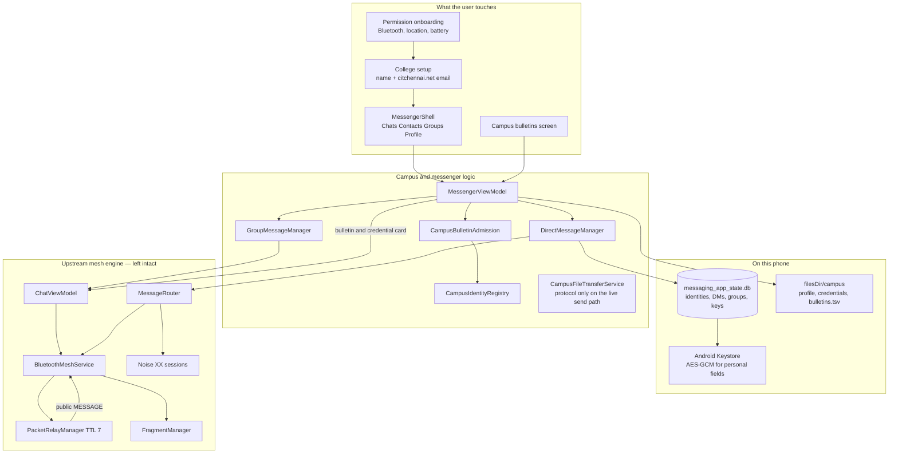
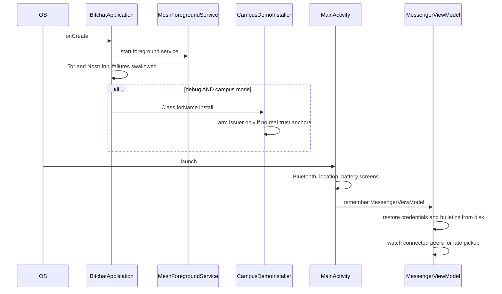
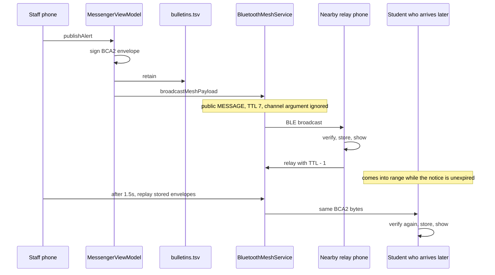
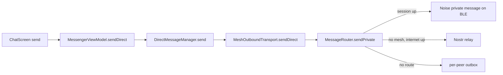
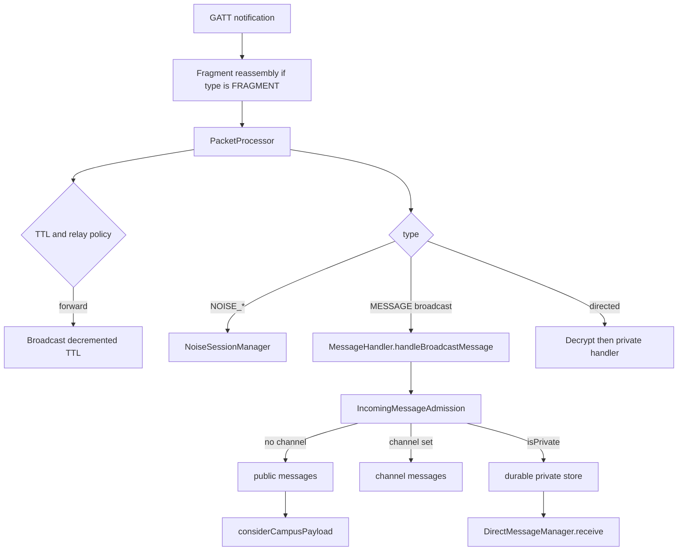

# Campus Mesh — architecture and how it works

This document describes the Android app in `campus-bitchat-android` as it is built today. It is written so you can walk an interviewer from the screen the user sees down to the Bluetooth packet, and so you can tell the truth about what is finished, what is unit-tested, and what has not been proven on two phones.

The product name in conversation is **Campus Mesh**. The Gradle application id is `com.bitchat.droid`. The Kotlin namespace is `com.bitchat.android`. The phone module is `:app`. There is also a `:wear` module; it is not the campus product.

---

## 1. What problem the app is solving

On a campus, cellular data and even SMS can disappear: concrete dead zones, and large events (the motivating example is Takshashila) where the shared network collapses. The app keeps two jobs working inside Bluetooth range:

1. **Staff bulletins.** A professor or admin publishes a short, signed, expiring notice. Nearby phones relay the bytes. A student who arrives later can still receive it while some awake phone nearby still holds an unexpired copy.
2. **Person-to-person messaging.** Students message each other with a college-linked identity, delivery states, and local history. Groups exist as an encrypted application protocol on top of the same mesh.

It is **best-effort**. It is not a guaranteed emergency channel. A notice that fails any check is **fail-closed**: it is not shown as an authentic bulletin.

The mesh engine is the upstream BitChat Android BLE stack. Campus code is an additive layer. It does not replace Noise, fragmentation, or the relay loop.

---

## 2. The stack, top to bottom



Read the diagram in three bands:

- **UI.** Permission screens come from upstream onboarding. After that, `BuildConfig.CAMPUS_MODE` chooses the messenger. Campus mode is the default.
- **Application.** Identity, bulletins, direct messages, and groups. This is the campus work.
- **Transport.** One binary packet format, BLE GATT, hop-limited relay, Noise for private bytes. Campus payloads are ordinary text inside that packet. The mesh does not know what a bulletin is.

---

## 3. Repository map

| Path | Role |
|---|---|
| `app/src/main/java/com/bitchat/android/MainActivity.kt` | Activity. Permission flow, then messenger or stock chat. |
| `BitchatApplication.kt` | Process start: mesh foreground service, Tor, Nostr, then the debug demo issuer. |
| `campus/` | Credentials, bulletin sign/verify, retention, late pickup, demo issuer hooks, file-transfer protocol, unused class-channel shell. |
| `campus/ui/` | Older class-channel Compose shell. **Not** what `MainActivity` shows. |
| `messaging/` | Messenger UI, DMs, groups, contacts, presence, SQLite. |
| `mesh/` | BLE connections, packet processing, relay, fragmentation, store-and-forward. |
| `noise/` | Noise protocol sessions (Java implementation under `noise/southernstorm`). |
| `protocol/BinaryProtocol.kt` | Packet header and `MessageType`. |
| `services/MessageRouter.kt` | Private messages: mesh now, Nostr if internet, or queue. |
| `services/IncomingMessageAdmission.kt` | Puts an incoming message into public, channel, or private state. |
| `sync/GossipSyncManager.kt` | Short in-memory window of recent public packets. |
| `identity/SecureIdentityStateManager.kt` | Upstream identity store. |
| `app/src/debug/.../CampusDemoInstaller.kt` | Debug-only Ed25519 demo root. Absent from release source. |
| `app/src/test/java/.../campus/` | JVM tests for verification, retention, relay policy, files. |

`gradle/libs.versions.toml` sets `minSdk = 26` (Android 8) because that is the floor for the BLE behavior this app uses.

---

## 4. How a process starts



`BitchatApplication` loads the demo issuer by reflection:

```kotlin
Class.forName("com.bitchat.android.campus.CampusDemoInstaller")
    .getMethod("install")
    .invoke(null)
```

The class lives only in `src/debug`. A release compile has no such class. The `catch` leaves verification fail-closed. If `CampusConfig.trustedInstitutionKeys` is non-empty, `install()` refuses to arm, so a real campus root cannot be silently overridden by the demo seed.

`MainActivity` then:

1. Runs `OnboardingCoordinator` until Bluetooth, location, and battery prompts are done.
2. If `BuildConfig.CAMPUS_MODE` is true, constructs `MessengerViewModel(application, chatViewModel)` and shows `MessengerShell`.
3. Otherwise shows the upstream `ChatScreen` (the IRC-style mesh UI). The flag is `-PcampusMode=true|false` in `app/build.gradle.kts`. Default is `true`.

The view model is created with `remember` inside composition. It is alive while that activity composition is alive. Late bulletin replay runs there, not inside the foreground service. If the process is swiped away, replay stops until the app is open again. The foreground service can still relay packets that are already on the air.

---

## 5. Two different keys (interviewers ask this)

The phone holds **two Ed25519 key pairs**. They are not interchangeable. `MessagingIdentityManager` documents the bug that happens if you mix them up.

| Key | Where it lives | What it is for |
|---|---|---|
| Announced signing key | Encryption service, encrypted prefs. Public half is derived, private bytes wiped after derive. | The key other phones learn. Signs bulletins. Named inside the campus credential. This is `MessagingIdentityManager.localPublicKey()`. |
| Noise static key | Noise identity store | Handshake and the encrypted private-message session. Not the campus identity. |

There is also a short **transport peer id**, 8 bytes, carried in every packet header as `senderID`. Peers are addressed on the radio by that id. People are addressed in the messenger by the 32-byte Ed25519 public key. `MeshPeerIdentitySource` is the join between those two.

A direct message that was encrypted to the announced key but checked against the Noise key used to be dropped on arrival. Both sides looked correct. The fix is to treat the announced key as the only messaging identity.

---

## 6. Screens

### 6.1 Permission onboarding (upstream)

`OnboardingState` walks Bluetooth availability, permission explanation, location (required for BLE scan on older Android), background location, and battery optimization. Skipping background location is allowed. Without scan permission the mesh cannot see neighbors.

### 6.2 College setup

`MessengerOnboardingScreen`, driven by `MessengerViewModel.needsSetup`.

Shown when:

- the user has never finished setup, or
- the debug demo issuer is armed and this phone has no verified college email yet.

Fields:

- **Your name.** Display name. Sanitized by `MessagingIdentity.sanitizeDisplayName`. This is not the email.
- **College email.** Must normalize and match `CampusConfig.institutionalEmailDomains`, currently `citchennai.net` (exact domain or a subdomain such as `cs.citchennai.net`). Gmail is rejected. The hint on screen is `name.dept2024@citchennai.net`.
- **Phone.** Optional. Stored encrypted with the identity, not published as a bulletin.

Debug builds call `CampusEmailChallenge.issue`. It returns a 6-digit code, valid for 10 minutes, compared in constant time. The screen prints the code and says no email is sent. There is no SMTP server. Confirming the code calls `completeSetup(..., emailVerified = true)`, which asks the demo issuer for a **STUDENT** credential bound to this phone's signing key (lifetime 180 days) and broadcasts it as a `BCC2:` card.

A release build, or a debug build that refused to arm, still lets the user continue. `emailVerified` is false. They can message. They are not shown as institutionally verified, and they cannot publish bulletins. Profile offers a paste box for a real credential token.

The institution title on that screen is `CampusConfig.institutionName`: **Chennai Institute of Technology**.

### 6.3 Messenger shell

Four tabs, Material 3, `MessengerRoutes`:

| Tab | Screen | What it lists |
|---|---|---|
| Chats | `ChatsScreen` | A **Campus bulletins** row, always, then direct conversations. |
| Contacts | `ContactsScreen` | Nearby identified peers, saved contacts, a count of nearby devices that have not proven a key. |
| Groups | `GroupsScreen` | Groups this phone belongs to. Create group from here. |
| Profile | `ProfileScreen` | Role, email standing, demo promotion codes, paste-credential, privacy, advanced. |

Detail routes: `chat/{peerKey}`, `contact/{peerKey}`, `group/{groupId}`, `create-group`, `alerts`, `privacy`, `advanced`. The bottom bar hides on those routes.

Geohash, Tor controls, and the raw peer terminal still exist in `ui/ChatScreen.kt`. Campus mode does not navigate to them.

### 6.4 Bulletins screen

`AlertsScreen`. Copy says notices are relayed, kept until expiry, and are not an emergency system. Cards use the tertiary color, not the error color, so a class-room change does not look like an alarm. Empty state explains class, exam, bus, and safety examples.

The publish composer is shown only when `canPublishAlerts()` is true (professor or admin credential currently verified). Title is capped at 80 characters, body at 500. Default life is 24 hours (`CampusConfig.defaultAlertLifetimeSeconds`).

---

## 7. Campus identity, in detail

### 7.1 Roles

`CampusRole`: `STUDENT`, `PROFESSOR`, `ADMIN`.

- `canPublishAlerts` is true only for professor and admin.
- `canManageConfiguration` is true only for admin.
- A role is trusted only after an institution signature verifies. Typing "Professor" in the name field does nothing.

### 7.2 Credential

`CampusCredential` is a public statement:

| Field | Meaning |
|---|---|
| displayName | Name the institution bound to this key |
| role | `STUDENT` / `PROFESSOR` / `ADMIN` |
| department | Free string. Demo student credentials use `"Student"`. |
| signingPublicKeyHex | 32-byte Ed25519 public key, hex |
| issuedAtEpochSeconds | Used so a newer credential replaces an older one |
| expiresAtEpochSeconds | `0` means no expiry. Demo issuer uses 180 days. |
| institutionSignature | Ed25519 over the canonical bytes |

Canonical bytes (`CampusCanonical`, length-prefixed fields, version `CAMPUS-CREDENTIAL-V1`) include the role. Changing `STUDENT` to `PROFESSOR` breaks the signature. The signature is not inside the signed bytes.

Wire form is base64url of those fields plus the signature. On the mesh it is announced as `BCC2:` + that token (`CampusCredentialAnnouncement`).

### 7.3 Who is trusted to sign a credential

`CampusCredentialVerifier` checks, in order: shape, revocation list, expiry, then signature against `CampusConfig.activeTrustAnchors`.

`trustedInstitutionKeys` in source is **empty**. `activeTrustAnchors` adds the debug demo public key only when `CampusDemoHooks` is armed and the key is 64 hex chars. `isDemoDeployment` stays true while the real list is empty. That flag is honest: an unprovisioned build is a demo, not campus IT.

`revokedSigningKeys` is an empty set compiled into the app. Revocation today ships with an app update. A stolen professor key is not withdrawn over the mesh.

### 7.4 Registry rules

`CampusIdentityRegistry.learn`:

- A failed credential never replaces a verified one for the same key.
- A still-valid credential with a **strictly newer** `issuedAt` wins. An older student credential cannot demote a professor after promotion (replay).
- Equal `issuedAt` replaces.
- A newer credential of a lower role does replace. That is how a real institution would demote someone. The demo promotion path always issues a new timestamp, so it wins.

The registry snapshots `activeTrustAnchors` in its constructor. The demo hook must be installed in `Application.onCreate` before `MessengerViewModel` is created. That is the order `MainActivity` already has.

### 7.5 Demo promotion

`CampusPromotion` maps codes, case-insensitive:

- `STAFF-DEMO` → professor
- `ADMIN-DEMO` → admin
- anything else → null

`promoteWithCode` requires the demo issuer, a code that maps, and an existing local credential. It re-issues the same name and key with the new role and a new `issuedAt`, stores it, and broadcasts `BCC2:`. Profile shows the codes and says this is not a real campus root. A professor can still enter `ADMIN-DEMO`. Email alone never promotes anyone.

This is an explicit second step, which matches the product rule "email is not enough." It is **not** an approval workflow. Anyone with the debug app can type the code.

### 7.6 What is stored for identity

`CampusDeviceStore` under `filesDir/campus/`:

- `profile.txt` — `email=`, `verified=1|0`, `local=` credential token. The email is local plaintext. It is not put in git. Do not log it.
- `credentials.txt` — one encoded credential per line. Credentials are public by design. `saveCredential` replaces the line for the same signing key.

Writes are temp file, delete destination, rename. If delete fails, write in place.

Personal names and phone numbers in the messenger database are different: they are AES-GCM under an Android Keystore key, bound to the row's public key so a ciphertext cannot be moved onto someone else's row (`MessagingDatabase`).

---

## 8. Bulletins, end to end

### 8.1 Create and sign

`CampusAlertSigner` uses the announced Ed25519 key.

It refuses the operation when:

- the local credential is missing, expired, or not professor/admin,
- the credential's key is not this device's key,
- the title is longer than 80 or the body longer than 500.

`CampusAlert` fields: id, title, body, timestamp, expiry, signer public key, device signature.

Signed bytes (`CAMPUS-ALERT-V1`) cover version, id, title, body, timestamp, expiry, and signer key. Editing the time or stretching the expiry breaks the signature the same way editing the text does.

The wire envelope is `BCA2:` plus base64url of those fields, the device signature, **and** the credential token. A receiver who has never seen this professor can still check the notice offline. There is no directory server.

### 8.2 Verify, fail-closed

`CampusAlertVerifier.verify` returns a sealed result. Only `Verified` is rendered.

Order:

1. Not `BCA2:` → `NotAnAlert` (ordinary chat is ignored, not rejected).
2. Cannot parse → `Malformed`.
3. Credential key must equal the key that signed the alert. Otherwise `IdentityMismatch`. This stops someone stapling a real professor credential onto an alert they signed themselves.
4. Device signature over canonical alert bytes. Otherwise `BadAlertSignature`.
5. Credential: revoked, expired, untrusted issuer, or malformed.
6. Role must be professor or admin. Otherwise `UnauthorizedRole`. A student future-dated alert fails here, not as `NotYetValid`, because role is checked first.
7. Timestamp further than 10 minutes ahead (`maxAlertClockSkewSeconds`) → `NotYetValid`.
8. Past expiry → `AlertExpired`.

`CampusBulletinAdmission.decide` maps that to `Ignore`, `Retain`, or `Reject`. Rejected text is not shown. A counter increments. The UI does not render the forgery with a warning, because a warning next to "exam cancelled" would still spread the text.

### 8.3 How it rides the mesh



`ChatViewModel.broadcastMeshPayload` calls `mesh.sendMessage(content)` and nothing else. That matters:

- `BluetoothMeshService.sendMessage` builds a version-1 `MESSAGE` packet (`0x02`), recipient `0xFF * 8` (broadcast), payload = UTF-8 bytes of the envelope, TTL = `AppConstants.MESSAGE_TTL_HOPS` (**7**). It signs the packet, then broadcasts.
- The `channel` parameter on `sendMessage` is **not written into the packet**. Campus does not depend on channel tags for bulletins. Recognition is the `BCA2:` prefix after decode.
- `MessageHandler` drops a broadcast whose sender peer id is this phone, so you do not receive your own packet as a neighbor would. The sender still shows the notice because it was stored locally before send.
- Incoming public text lands in `AppStateStore` public messages with **no channel**. `MessengerViewModel` collects `chatViewModel.messages` and runs `considerCampusPayload` on each body.

`considerCampusPayload`:

- Dedupes on the full string for this process. A notice seen once as `NotYetValid` is not retried later when its timestamp becomes valid.
- `BCC2:` → learn credential, do not treat it as a bulletin.
- `BCA2:` and `Retain` → learn publisher, write the store, refresh the list.
- `Reject` → increment rejected count.
- Anything else → ignore.

### 8.4 Retention and late pickup

`CampusBulletinStore` file `filesDir/campus/bulletins.tsv`, columns `id`, `expires`, `timestamp`, `envelope`.

- `retain` drops non-envelopes and rows already expired.
- Cap is **40**. The oldest timestamp is dropped.
- `activeEnvelopes` purges expired rows and returns newest first.
- Restart reads the file. `load` does not rewrite it.

`CampusBulletinRelay.onPeers`:

- Empty peer set clears the "already offered" set and sends nothing.
- No payloads, or no new peer since last offer, sends nothing.
- An observation with **no** payloads does not mark peers as served, so a bulletin published a moment later is still offered.
- Otherwise it marks the current set and returns the payloads to send.

`watchPeersForLatePickup` cancels the previous job, waits **1.5 seconds** (peer-list flaps collapse into one send), re-verifies every stored envelope, adds the local `BCC2:` card, and broadcasts each one. Tampered disk is not relayed.

Mesh `StoreForwardManager.cacheMessage` **skips broadcasts**. The 12-hour private-message cache does not hold bulletins. `GossipSyncManager` answers `REQUEST_SYNC` from a short in-memory public window. That can help a phone that missed a live packet in the same session. It is not the campus retention design. Campus retention is the TSV file plus the rebroadcast above.

Limits an interviewer should hear:

- Hop limit 7. A packet that has been forwarded 7 times is not forwarded again (`PacketRelayManager` decrements TTL and stops at 0).
- Android may scan slowly in the background. A phone with the screen off is a poor relay.
- Expiry is inside the signature. Nobody can extend it without breaking verification.
- Late pickup needs an awake app that still has a valid copy and sees the new peer.

### 8.5 Publish path versus the old channel path

An earlier design joined `#CampusAlerts` and called `ChatViewModel.sendMessage`. That follows whichever conversation is open, and the mesh still would not put the channel name on the wire. Bulletin publish does not do that anymore. `CampusViewModel` (the unused class shell) still combines channel messages and public messages so older local state is visible if that shell is ever opened. `MainActivity` does not open it.

---

## 9. Direct messages

### 9.1 Envelope

Application messages are not raw chat strings. `MessagingEnvelope` plus `EnvelopeAdmission` check kind, length, and that the authenticated sender matches the key inside the envelope. The sender key is taken from the peer table (`authenticatedKeyFor`), not from the text. A body that claims to be someone else is rejected.

Control payloads (profile card, group invite, key distribution, delivery receipt) are a different kind and are not rendered as chat bubbles.

### 9.2 Send path



`MeshOutboundTransport` resolves a messaging public key to a transport peer id. If there is no proven peer, the result is `QUEUED`, not a silent send to "whoever the chat screen has open." That bug is why this type exists: the older `sendMessage` follows the selected conversation.

`MessageRouter.RouteResult`: `MESH`, `NOSTR`, `QUEUED`, `DROPPED`. Mapped to delivery state by `SendOutcome`.

Noise transport payloads are capped around **256 bytes** (`AppConstants.Noise.MAX_PAYLOAD_SIZE_BYTES`). A long DM is refused in the manager (`TooLong`) rather than truncated onto the wrong path.

### 9.3 Delivery states

`DeliveryState`, with an explicit progress rank so a queued message can still advance:

| State | Progress | Label | Meaning |
|---|---|---|---|
| SENDING | 0 | Sending | Handing to the transport |
| PENDING_OFFLINE | 1 | Waiting to deliver | No route. Held. This is normal on a mesh. |
| SENT | 2 | Sent | Mesh or Nostr accepted it. Not yet known to have arrived. |
| DELIVERED | 3 | Delivered | Recipient device acked |
| READ | 4 | Read | Recipient opened the conversation |
| FAILED | none | Not sent | Will not be retried |

A later receipt cannot move the state backwards. `READ` and `FAILED` are terminal. Receipts are themselves small control messages on the private path (`DeliveryReceipt`). The state machine is unit-tested with a fake transport (`DirectMessageManagerTest`). It has not been demonstrated on two physical radios in this repo's test suite.

### 9.4 Persistence

Schema version 3 of `messaging_app_state.db` (`MessagingDatabase`):

- `identities` — public key, encrypted display name, encrypted phone, contact flag, blocked flag, seen times.
- `direct_messages` — id, conversation id, sender, recipient, **encrypted** body, time, outgoing flag, delivery state.
- `read_conversations` — conversation id, read time.
- `groups_`, `group_members`, `group_keys` — group metadata and key material, encrypted. **Not** group message bodies.

Keystore alias `bitchat_messaging_storage_v1`. `PRAGMA secure_delete = ON`. Foreign keys on. WAL on.

This database is separate from the upstream conversation database on purpose. The stock UI opens the upstream database. Adding campus tables there would migrate installs that never use them.

`DirectMessageManager.restore` runs at startup so the chat list is not empty for a moment and then fills in.

### 9.5 Presence

`PresenceResolver` does not send presence packets. It reads who the mesh already knows:

- In `connectedPeerIds` and a direct GATT link → **directly reachable**.
- Connected but only through a relay → **mesh reachable**.
- Not connected, last seen within **5 minutes** → **recently seen**.
- Older than that → **offline**.
- No observation → **unknown**.

UI: `PresenceDot` and `NameWithPresence`. Unidentified nearby devices are counted, not given someone else's name.

### 9.6 Contacts and privacy

`ContactRepository` marks a peer as a saved contact or blocked. Blocked peers are refused in `sendDirect`. `PrivacySettingsStore` holds the messenger privacy switches. A "hide me" switch is intentionally absent: BLE advertisements are visible to every radio in range, and hiding a row in this app would not hide the phone.

---

## 10. Groups

### 10.1 Data model

`Group` has an id, name, description, creator, created time, members, and default permissions. `GroupPermission` includes ordinary member and read-only. An announcement-only group is created by giving members `READ_ONLY`.

`GroupManager` is the membership authority on this phone. Adding or removing a member is allowed only for a member whose role is administrative.

### 10.2 Key and encryption

`GroupKey` is 32 random bytes plus a version, from `SecureRandom`. It is not derived from a password baked into the APK. Removing a member rotates the version. Old ciphertext does not open under the new key.

`GroupCipher.seal` is AES-256-GCM, 12-byte random IV, 128-bit tag. Group id and key version are associated data, so a ciphertext cannot be moved into another group or another key generation. The same plaintext seals differently each time because the IV changes.

Wire body, prefix `BCG1:`:

```text
BCG1: base64url( groupId, messageId, senderKeyHex, keyVersion, sealed )
```

`receive` requires:

- the prefix and a clean decode,
- an authenticated transport sender,
- the sender hex inside the wire equals that authenticated key,
- this phone is a member and holds that key version,
- the sender is a member with permission to speak,
- GCM open succeeds.

An outsider who does not hold the key cannot decrypt, and a message that does not decrypt does not add them to the member list. Membership learned from traffic uses `groupProvenByDecryption`: only a successful open under the group key counts.

### 10.3 How the key is distributed

Invites go out as **private control messages**, one recipient at a time (`GroupInvite`, then `DirectMessageManager.sendControl`). The key is not written onto the group channel. A rotation uses the same private path (`distributeGroupKey`). A key packet is accepted only from someone this phone already believes is an admin or owner of that group. Otherwise anyone nearby could send a fake "rotation."

The invite does not list every member. When someone later speaks and the message decrypts, `learnGroupMemberFrom` adds them. That is why a message can arrive before the speaker is on the local member list (`SenderNotAMember`, then learn, then receive again).

### 10.4 Where group text is supposed to travel, and the gap

`GroupMessageManager.send` calls a transport lambda in `MessengerViewModel`:

1. `chatViewModel.joinChannel("#g_" + groupId)`
2. `switchToChannel` of that tag
3. `sendMessage(envelope)`

`joinChannel` only updates local `ChatState`. `BluetoothMeshService.sendMessage` then emits a **public** `MESSAGE` and ignores the channel. The receiver's `MessageHandler.handleBroadcastMessage` builds a `BitchatMessage` **without** a channel. `IncomingMessageAdmission` therefore stores it as a public message.

`drainGroupTraffic` only reads `channelMessages`. The public-message collector only runs `considerCampusPayload`, which understands `BCA2:` and `BCC2:`, not `BCG1:`.

So, on two phones today:

- Creating a group and sending the invite can work, because the invite is a private message.
- The sender sees their own group text, because `GroupMessageManager` records it locally before the radio send.
- The other phone does not feed `BCG1:` into `GroupMessageManager`, so the bubble does not appear.
- `listenToGroupChannel` does not subscribe the radio to anything. There is no channel filter in the packet.

The unit test `a message that arrives before the invitation is delivered once it lands` calls `receive()` twice inside the test. It proves the manager is idempotent and can decrypt once it has the key. It does not prove the BLE path.

Group **bodies** live in a `MutableStateFlow` on `GroupMessageManager`. Process death clears them. Group records and keys survive in SQLite.

`switchToChannel` also clears the selected private-chat peer in `ChatState`. Messenger DMs do not use that selection; they use `OutboundTransport`. The side effect still mutates shared chat state on every group send.

If an interviewer asks "do encrypted groups work on the mesh," the accurate answer is: the cryptographic protocol and the invite path are implemented and unit-tested; delivery of group text between phones is not wired to the packet the mesh actually sends. Fixing it is a small campus-layer change (recognize `BCG1:` on the public-message collector, the same way bulletins recognize `BCA2:`). It is not a mesh rewrite. It is not done.

---

## 11. Files

There are two mechanisms. Do not describe them as one.

### 11.1 What the messenger button does

`ChatScreen` attachment picker → `MessengerViewModel.sendAttachment` → `chatViewModel.sendImageNote` / `sendVoiceNote` / `sendFileNote`.

That is the upstream BitChat file packet (`BitchatFilePacket`, message type `FILE_TRANSFER` `0x22`). Content TLV can be split at 65535 bytes. The outer packet is version 2 so the payload length can exceed what a 2-byte field holds. BLE fragmentation then splits that packet again (`FragmentManager`, threshold 512 bytes, fragment size 469, timeout 30 seconds, caps on fragment count and bytes). Private files require a valid packet signature. Unsigned directed files are dropped.

### 11.2 The campus sliding-window protocol

`CampusFileProtocol` / `CampusFileTransferService`:

- Point-to-point. Envelopes from anyone other than the counterparty are ignored.
- Chunk size **32 KB**, window **8**, cumulative ack, pause when the send fails, resume from the ack, SHA-256 checked before the file is accepted.
- No Android types. `CampusFileTransferTest` drives two in-memory services. That is why windowing, gaps, corruption, and stranger acks are tested without a radio.

`MessengerViewModel` still constructs a `CampusFileTransferService` whose transport is `DirectMessageManager.send`, and `handleIncoming` still looks at private message bodies. The compose send button does **not** call `offerFile`. A 32 KB chunk also does not fit the ~256-byte Noise plaintext cap, so this service cannot move a real document over the private text path as written.

Say this in an interview if asked: a tested application-layer transfer state machine exists; the screen the user taps uses the upstream file packet and BLE fragmentation instead.

---

## 12. The mesh engine

Campus code calls into this. It does not own it. Know the shape so you can explain why bulletins are plain public packets.

### 12.1 Packet

`BitchatPacket` header, big-endian, compatible with the iOS app:

| Field | Size |
|---|---|
| Version | 1 byte. v1 payload length is 2 bytes. v2 payload length is 4 bytes. |
| Type | 1 byte |
| TTL | 1 byte, hops |
| Timestamp | 8 bytes |
| Flags | 1 byte: has recipient, has signature, is compressed |
| Payload length | 2 or 4 bytes |
| Sender id | 8 bytes |
| Recipient id | 8 bytes, only if the flag is set. All `0xFF` means broadcast. |
| Payload | compressed with DEFLATE when the flag says so, above 100 bytes |
| Signature | 64 bytes when the flag is set |

`WirePayload` keeps the exact compressed bytes. Re-compressing on relay would change the signature preimage, because Java Deflater and Apple's compressor do not produce identical output. Relay re-encodes the packet with the original wire payload and a lower TTL.

Types you will be asked about:

| Type | Value | Use |
|---|---|---|
| ANNOUNCE | `0x01` | Identity and nickname. Not cached for store-and-forward. |
| MESSAGE | `0x02` | Public text and, on a private path, directed text. Bulletins are this type. |
| LEAVE | `0x03` | Peer leaving |
| NOISE_HANDSHAKE | `0x10` | Noise handshake messages |
| NOISE_ENCRYPTED | `0x11` | Noise transport message |
| FRAGMENT | `0x20` | One piece of a large packet |
| REQUEST_SYNC | `0x21` | Gossip sync, TTL 0, neighbor only |
| FILE_TRANSFER | `0x22` | File packet |
| VOICE_FRAME | `0x29` | Live push-to-talk. Not put in gossip sync. |

### 12.2 BLE

`BluetoothMeshService` is the phone transport. GATT service `F47B5E2D-4A9E-4C5A-9B3F-8E1D2C3A4B5C`, characteristic `A1B2C3D4-E5F6-4A5B-8C9D-0E1F2A3B4C5D`. The phone is both a GATT server and a client (`BluetoothGattServerManager`, `BluetoothGattClientManager`). `BluetoothPacketBroadcaster` writes to connected peers.

`PeerManager` forgets a peer after about **3 minutes** without traffic (`STALE_PEER_TIMEOUT_MS`). Connection attempts retry every 5 seconds, up to 3.

`UnifiedMeshService` can also bring in Wi-Fi Aware (`wifi-aware/`). Campus bulletins do not special-case the link. They call `sendMessage` and take whatever link the mesh service is using.

`MeshForegroundService` is a foreground service so the process is less likely to be killed while the user expects the mesh to stay up. It does not, by itself, replay `bulletins.tsv`.

### 12.3 Receive path



Public messages from a peer that has not completed nickname verification are dropped (`isVerifiedNickname`). That is an upstream anti-spoof check on the announce path. It is separate from campus credential verification.

### 12.4 Relay

`PacketRelayManager` will not forward TTL 0. Otherwise it decrements TTL. High TTL (4 or more) is always forwarded. Lower TTL still follows the usual relay rules (duplicate suppression, who we are connected to). Campus does not change this. A bulletin is forwarded because it is a normal signed public message, for as many hops as TTL allows.

### 12.5 Fragmentation

Packets larger than **512** bytes are split into fragments of at most **469** bytes. A fragment set times out in **30 seconds**. Caps: 256 fragments per id, 1 MB per set, 64 active sets, 4 MB global. This exists so a BLE MTU can carry a file or a large compressed payload. A short bulletin is usually one packet.

### 12.6 Store-and-forward and gossip

`StoreForwardManager` caches some **directed** messages for offline peers (12 hours, 100 messages, 1000 for favorites). It skips handshakes, announces, leaves, and **broadcasts**. Bulletins are broadcasts, so this cache does not keep them for a late student.

`GossipSyncManager` remembers recent public packets in memory and answers a neighbor `REQUEST_SYNC` (TTL 0). It is not expiry-aware and not a disk store. Useful for a phone that connects a few seconds late. Not a substitute for `CampusBulletinStore`.

### 12.7 Noise

Private DMs use the Noise handshake (`NOISE_HANDSHAKE`) and then `NOISE_ENCRYPTED`. Sessions rekey after about an hour or a message count (`AppConstants.Noise`). Campus group keys are a different layer: they are random AES keys carried inside an already Noise-encrypted private message. The group ciphertext is defense against relays who can see a public packet. The Noise session is defense against relays who can see a directed packet.

### 12.8 Channel passwords, stated accurately

`ChannelManager.verifyChannelPassword` compares SHA-256 commitments of a derived AES key when this phone already has a commitment. If it has never seen the channel, it accepts the password and relies on decryption to fail later. `sendEncryptedChannelMessage` returns immediately (`TODO: REIMPLEMENT`). Class channels in `CampusConfig.classes` (`#CS101` and the rest) are static demo rows. Their password is `SHA-256(code + "InstitutionalSecret2026")`, and that secret is in the APK. Those screens live in `campus/ui/CampusShell.kt`, which the running app does not open. Do not claim a protocol-level channel-encryption fix as a finished feature.

---

## 13. Other upstream pieces that are in the binary

They build. Campus mode does not lead the user to them. Know they exist so you do not claim the app is "only" the campus layer, and so you do not demo them by accident.

| Area | What it is |
|---|---|
| `nostr/` | Internet relay for private messages and geohash chats when the mesh cannot deliver. |
| `net/ArtiTorManager.kt` | Optional Tor for Nostr. |
| `geohash/` | Location channels over the internet, not over the campus bulletin path. |
| `features/voice/` | Push-to-talk frames. Ephemeral. Not a bulletin. |
| `hotspot/` | Local APK download hotspot. |
| `favorites/` | Upstream favorite peers, which get a larger store-and-forward cache. |

`MessageRouter` may send a DM via Nostr when the recipient is a favorite and the mesh session is down. A bulletin never takes that path. Bulletins are local radio only.

---

## 14. Persistence map

| Data | Where | Survives process death | Encrypted at rest |
|---|---|---|---|
| Display name, phone, contacts, blocks | `messaging_app_state.db` identities | Yes | Yes, Keystore AES-GCM |
| DM bodies and delivery state | same DB, `direct_messages` | Yes | Yes |
| Group membership and group keys | same DB | Yes | Yes |
| Group message text | memory in `GroupMessageManager` | No | n/a |
| College email and verified flag | `filesDir/campus/profile.txt` | Yes | No |
| Credential tokens | `filesDir/campus/credentials.txt` | Yes | No. They are public. |
| Bulletins | `filesDir/campus/bulletins.tsv` | Yes, until expiry or the 40-cap | No. They are public. |
| Announced Ed25519 private key | EncryptedSharedPreferences | Yes | Yes |
| Noise session | Noise stores | Yes, until rekey or wipe | Yes |
| Recent public gossip | `GossipSyncManager` memory | No | n/a |
| Directed offline queue | `StoreForwardManager` | Process lifetime of the mesh service | Payload is already a private message |

---

## 15. Build, run, test

JDK **21** is required. On this machine the default `JAVA_HOME` is 23 and the Android Gradle plugin will not provision 21 by itself.

```bash
# In repository root
export JAVA_HOME=/path/to/jdk-21
export ANDROID_HOME="$HOME/Library/Android/sdk"
export PATH="$ANDROID_HOME/platform-tools:$PATH"
adb devices
./gradlew :app:installDebug
adb shell am start -n com.bitchat.droid/com.bitchat.android.MainActivity
```

`local.properties` (gitignored) must contain `sdk.dir` pointing at the Android SDK. `adb` is not on the default shell path.

Debug install: campus UI, demo issuer, on-screen email code, promotion codes.

```bash
./gradlew :app:installDebug -PcampusMode=false
```

That build shows the stock chat UI. The demo installer is also gated on `CAMPUS_MODE`.

```bash
./gradlew :app:testDebugUnitTest --tests 'com.bitchat.android.campus.*'
```

Campus JVM tests cover credential and alert verification (including forged, expired, wrong role, revoked, future-dated), registry replay, bulletin admission, disk retention, relay peer-set policy, the demo installer public key, and the file-transfer state machine. There is **no** `app/src/androidTest` suite. Nothing in CI attaches two radios.

A demo on hardware, said honestly:

1. Two debug installs, Bluetooth on, permissions allowed.
2. Each phone: a real name, then an `@citchennai.net` address, then the 6-digit code shown on screen.
3. One phone, Profile, `STAFF-DEMO`. Say it stands in for a campus IT signature.
4. Publish a short bulletin. It shows on the sender immediately.
5. Second phone comes into range. Within a couple of seconds, if the first app is still open, the notice should verify and appear. Force-stop and reopen the second phone: the notice should still be there until the 24-hour expiry.
6. Do not promise group chat or the sliding-window file protocol on that hardware until you have watched those exact screens succeed.

---

## 16. Threat model you can defend

| Attack | What the code does |
|---|---|
| Student publishes a bulletin with a valid student credential | `UnauthorizedRole`. Not shown. |
| Attacker edits title, body, time, or expiry | Device signature fails. |
| Attacker staples a professor credential onto their own signature | `IdentityMismatch`. |
| Attacker replays an old student credential after a promotion | Registry keeps the newer `issuedAt`. |
| Credential signed by an unknown key | `UntrustedPublisher`. Release builds with an empty anchor list reject every credential. |
| Expired or revoked publisher | Separate results. Neither is shown. |
| Notice dated more than 10 minutes in the future | `NotYetValid`. |
| Random chat text that happens to be nearby | `NotAnAlert`. Ignored. Not counted as a forgery. |
| Group ciphertext observed by a relay | AES-GCM. Relay can forward bytes it cannot read. |
| Fake group-key rotation from a stranger | Refused unless the sender is an admin on the local membership list. |
| DM addressed to the wrong conversation because a screen is open | `OutboundTransport` addresses by public key, not by selected peer. |

What you should not defend:

- The debug issuer seed is in the debug source set. Anyone with the project can mint a professor credential for the demo root. It is not campus IT.
- Promotion codes are printed in Profile.
- `profile.txt` stores the college email in the clear on the device.
- Revocation is an empty compiled set.
- Group text does not complete the trip described in section 10.4.
- There is no institutional PKI, no SMTP, and no guarantee a notice reaches every phone.

---

## 17. Interview questions

Answers below match the code. If a question assumes a feature is finished on two phones, say how far the code actually goes.

### Product

**Why not WhatsApp?** WhatsApp needs the cellular network or Wi-Fi that has already failed. This app only needs Bluetooth between phones that are physically near each other.

**Is this an emergency system?** No. Best-effort, hop-limited, and dependent on phones being awake and in range. The bulletin screen says that.

**What did you add, versus the upstream app?** The campus credential and bulletin trust chain, disk retention and late rebroadcast, college-email onboarding for this demo, the four-tab messenger, DM delivery states and their database, and the group crypto protocol. The BLE packet format, Noise, fragmentation, and relay are upstream.

**Why leave the mesh alone?** The packet format is shared with the iOS BitChat app. A campus-specific packet would not be relayed by a phone that only understands the existing types. Putting a `BCA2:` string in a normal public `MESSAGE` means every existing relay forwards it.

### Identity

**Why is college email not enough to publish?** Email, in this build, proves the user typed `@citchennai.net` and a code the same phone displayed. Publishing needs a credential whose role is professor or admin, signed by a trust anchor, naming this device's key. The demo splits those steps: email issues `STUDENT`, `STAFF-DEMO` issues a newer professor credential.

**Where is the private institutional key?** Not in the release app. The debug installer holds a demo seed and checks that the derived public key matches a constant before it arms. A production deployment would put only public keys in `trustedInstitutionKeys` and issue credentials out of band. When that list is non-empty, the demo installer does nothing.

**Two Ed25519 keys. Why?** One is the Noise static key. The other is the key announced to peers and named by the credential. Messaging and bulletins must use the announced key. Using the Noise key makes every peer look like a stranger and drops DMs.

**Can I change my role by editing the credential token?** No. The role is inside the signed canonical bytes. Edit it and verification fails.

**How does a late phone trust a professor it has never seen?** The bulletin envelope carries the credential. The phone checks the institution signature against anchors compiled into the app. No server lookup.

**What if two credentials exist for one key?** The newer `issuedAt` that still verifies wins. An older replay cannot roll a promotion back.

### Bulletins

**Walk a bulletin from tap to the other phone.** Sign locally, append to `bulletins.tsv`, call `broadcastMeshPayload`, which is `mesh.sendMessage`. The packet is a public `MESSAGE`, TTL 7. The other phone's public-message collector sees `BCA2:`, runs `CampusAlertVerifier`, and only then adds a card. It also stores the envelope so it can replay it.

**Why not use store-and-forward?** That cache skips broadcasts. A bulletin is a broadcast, on purpose, because it is for everyone nearby rather than one peer. Late pickup is an application replay of envelopes that still verify.

**What is the hop limit and why does it matter?** TTL starts at 7 and drops by 1 at each relay. A notice does not flood the whole campus forever. Range is "a handful of phones deep," not the whole city.

**A student signs a perfect alert. What happens?** Signature step passes. Role step returns `UnauthorizedRole`. The text is not shown.

**Someone copies a real professor credential onto their own alert.** `IdentityMismatch`, because the credential names a different key than the one that signed the alert.

**Clock skew.** More than 10 minutes in the future is `NotYetValid`. Role is checked before skew, so a student does not get the clock error.

**Why dedupe before retry?** `considerCampusPayload` remembers the exact string. A far-future notice seen once will not be reconsidered when it becomes valid. That is fail-closed, and it is a real limitation.

**Why cap at 40?** A phone should not become an unbounded disk cache of every notice it has ever heard. Oldest timestamp is dropped. Expired rows are dropped on read.

### Messaging

**What does each tick mean?** Sending, waiting to deliver, sent, delivered, read, not sent. "Sent" means the transport took it. "Delivered" means the other phone acked. On a mesh those are far apart, so they are different states.

**Why is "waiting to deliver" not an error?** The person may walk back into range. The private outbox retries. Progress rank puts `PENDING_OFFLINE` below `SENT` but above `SENDING`, using an explicit integer, not the enum ordinal. Using the ordinal once made a queued message unable to advance.

**Where is the DM stored?** `direct_messages` in `messaging_app_state.db`, body encrypted with a Keystore AES-GCM key, associated data bound to the public key of the row.

**How does presence work without a presence protocol?** It is derived from mesh connectivity and last-seen. Direct link and relayed link are different because a relay can walk away.

### Groups and files

**How is a group encrypted?** A random 32-byte AES-256-GCM key, versioned. Members get it inside a Noise-encrypted private invite, not in the group broadcast. Removal rotates the version. Associated data binds ciphertext to group id and version.

**Will I see the message on a second phone today?** You should see the invite. You should not expect the group bubble. The send path labels a channel locally, but the packet that leaves the radio is a public message with no channel, and the receiver only decrypts group traffic that was filed under a channel. Say that before they try it.

**Out-of-order messages?** The manager can decrypt a body that is offered again after the key arrives, and it dedupes by message id. That is unit-tested in memory. On the radio, the body is not sitting in `channelMessages`, so the retry does not happen by itself.

**Sliding window?** Implemented and tested in `CampusFileTransferService`: 8 chunks in flight, 32 KB chunks, cumulative ack, SHA-256. The attachment button uses the upstream `FILE_TRANSFER` packet and BLE fragmentation instead. Those 32 KB chunks do not fit a Noise private-text payload.

### Mesh

**Describe the packet.** Version, type, TTL, timestamp, flags, length, 8-byte sender, optional 8-byte recipient, payload, optional 64-byte signature. Broadcast recipient is eight `0xFF` bytes.

**Why keep the compressed payload bytes on relay?** Signature verification re-encodes. DEFLATE is not canonical across Java and Apple. Re-compressing would make a valid signature fail.

**What does the foreground service guarantee?** It makes the process harder to kill and keeps BLE up. It does not replay campus bulletins. That replay is in the view model, so the app has to be open.

**What is the BLE service UUID?** `F47B5E2D-4A9E-4C5A-9B3F-8E1D2C3A4B5C`. Knowing it matters if someone asks how phones find each other without an internet rendezvous.

### Engineering judgment

**Why a second SQLite file?** So the stock BitChat build does not take a schema migration for tables it will never read.

**Why is the class shell still in the tree?** It was an earlier UI. The product UI is the messenger. Deleting it was out of scope. It is not on the launch path. Its channel encryption send path is still a stub.

**How would a real college deploy this?** Put the college's Ed25519 **public** keys in `trustedInstitutionKeys`, keep `institutionalEmailDomains` as `citchennai.net`, ship a release build so the demo installer is gone, and issue credentials from a machine that holds the private key. Paste or transfer the token to the staff phone. Do not put the private key in the app.

**What would you build next, in order?** Recognize `BCG1:` on the public-message path so group text actually arrives. Persist group bodies. Only then talk about connecting the sliding-window sender, and only with a transport that can carry 32 KB chunks. Leave Noise and the packet header alone.

---

## 18. One-page oral version

Campus Mesh is a layer on the BitChat Bluetooth mesh. Phones relay a normal public message, seven hops, no internet.

A bulletin is a `BCA2:` string. The device key signs the text and the expiry. A credential signed by an institutional key is stapled on, and it names that same device key and a role. Receivers check both signatures offline. Students, forgeries, expiry, revocation, and clock skew fail closed and are not shown. The phone keeps up to 40 unexpired envelopes on disk and rebroadcasts them when a new peer appears, which is how a late student gets the notice. The mesh's own store-and-forward does not cache broadcasts.

Identity for this demo is an `@citchennai.net` address plus an on-screen code, which issues a student credential. Staff rights are a second step, `STAFF-DEMO` or `ADMIN-DEMO`, and only on the debug build. A release build without real public keys verifies nothing.

Direct messages go through Noise, addressed by the announced Ed25519 key, with delivery states stored encrypted in SQLite. Group messages are AES-GCM under a random key that is invited over that private path. The group ciphertext protocol is tested. The radio delivery of group text is not finished, because the mesh packet has no channel field and the receiver is still listening on a channel. Attachments use the upstream file packet. A separate sliding-window protocol is unit-tested and is not what the button sends.

That is the whole system.
